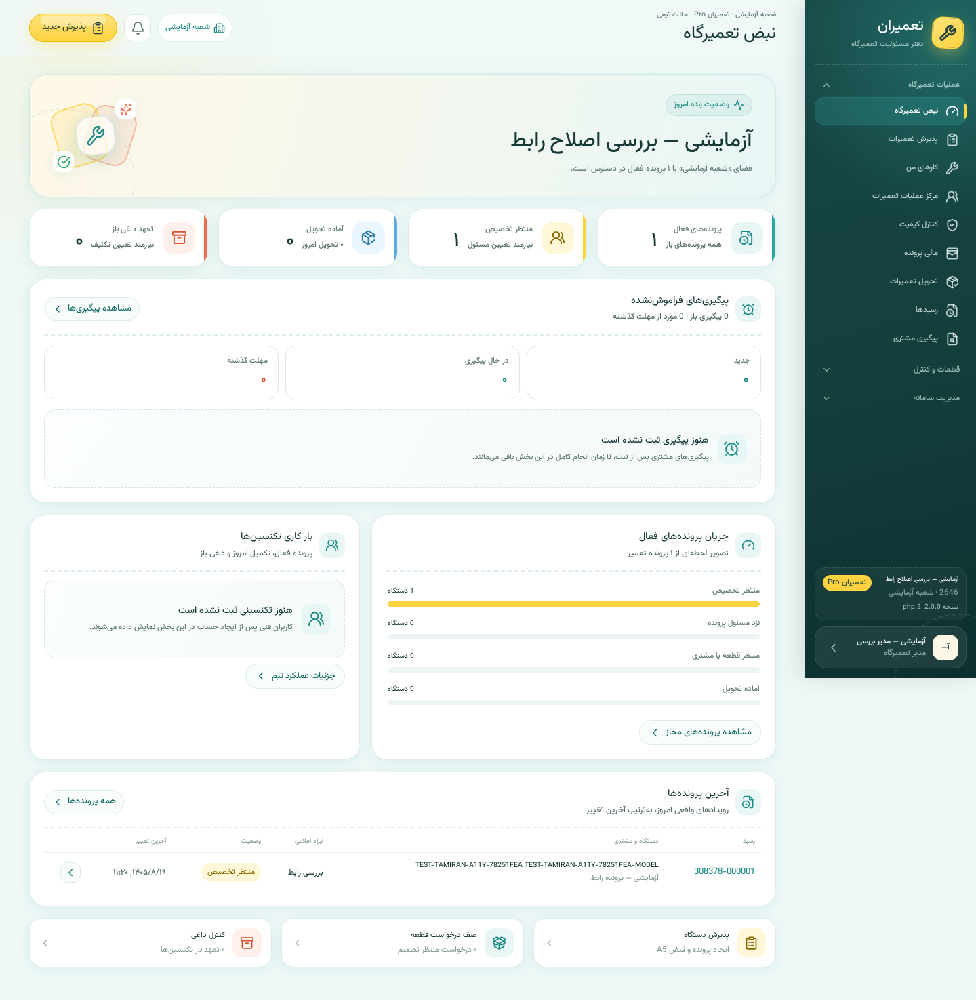
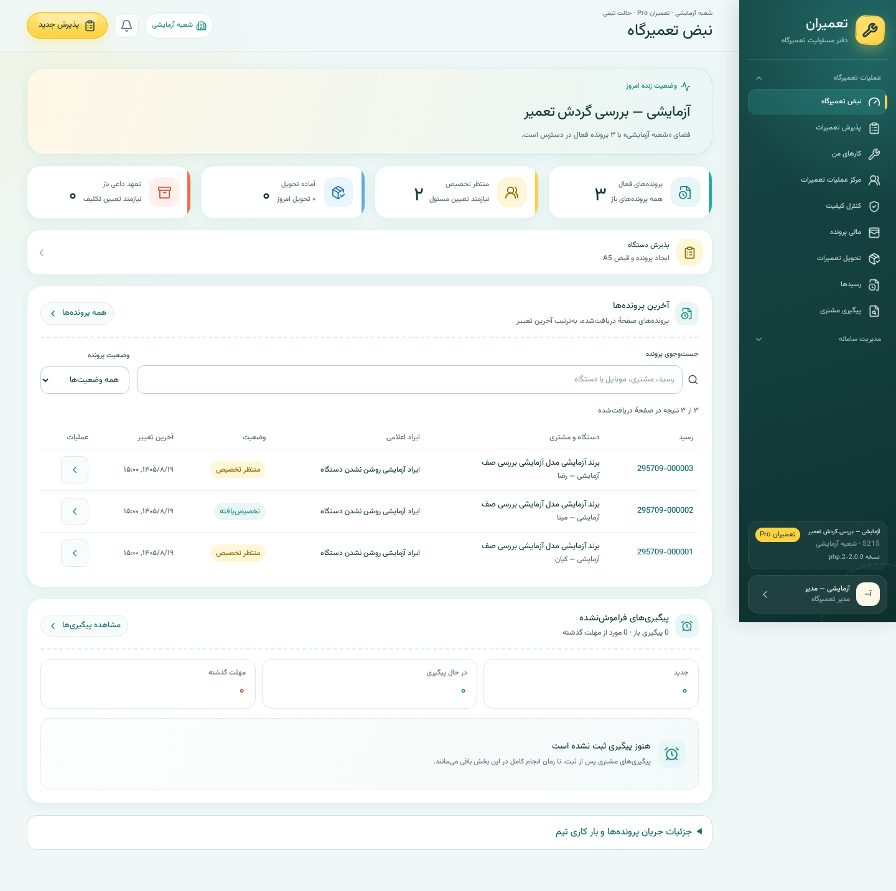
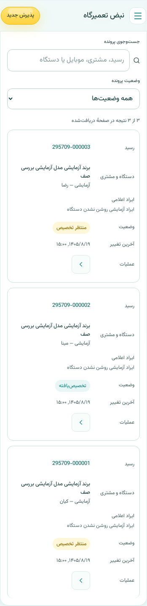
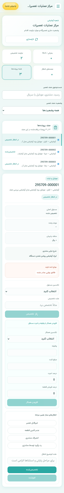
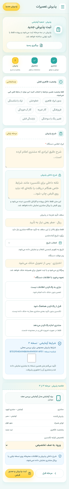

# بررسی جریان کاری تعمیران — ۱۰ نوامبر ۲۰۲۶

مبنای شروع: `62101d4c360da916df6663ea5627d1a2037d0c6c`. نسخهٔ هدف، **PHP/MySQL در hosting** است؛ Worker مهاجرتی و مرجع منجمد runtime مشترک با آن ندارند. این نوبت، اصلاح سورس و بررسی محلی با دادهٔ مصنوعی است؛ انتشار روی هاست انجام نشده است.

## نتیجه و اصلاحات

| یافته | اثر | اصلاح |
|---|---|---|
| فایل قفل npm به مسیرهای محلی `.pnpm` نسخهٔ Worker لینک داشت | `npm ci` در checkout تازه ظاهراً موفق بود، ولی `tsc` و Vite وجود نداشتند | lockfile مستقل registry، همراه integrity؛ نصب تمیز و ساخت دوباره موفق |
| پاسخ تکراری تحویل فقط با shop و کلید یکتا بازیابی می‌شد | با کلید شناخته‌شده، همان تعمیرگاه می‌توانست پاسخ پروندهٔ دیگری یا شعبهٔ دیگری را دریافت کند | `v2_delivery_replay` به شعبه و پرونده محدود شد؛ مسیر عادی و بازیابی پس از خطای duplicate از یک helper استفاده می‌کنند |
| Vite 8.0.13 در audit یک وابستگی آسیب‌پذیر با شدت high داشت | ریسک مربوط به محیط توسعه/ابزار ساخت، از جمله مسیرهای editor و file serving؛ Vite روی هاست PHP اجرا نمی‌شود | ارتقا به نسخهٔ دقیق 8.3.7؛ audit نهایی صفر مورد |
| صف داشبورد پس از بخش‌های خالی و نمودارها قرار داشت | کار روزانه زیر چند صفحه اطلاعات کم‌اولویت بود | صف و اقدام‌های روزانه بالاتر؛ جزئیات جریان و تیم در بخش بازشدنی با کیبورد حفظ شدند |
| متن خوشامد تعداد پرونده‌های صفحه را به‌عنوان کل نشان می‌داد | در بیش از ۲۵۰ پرونده با شاخص سرور متفاوت می‌شد | استفاده از summary سرور؛ نمودارها و فیلتر محلی صریحاً به صفحهٔ دریافت‌شده محدودند |
| جدول و فیلترها برای نام/اعداد فارسی و موبایل کامل نبودند | پیدا کردن پرونده دشوار؛ انتخاب فیلتر برای صفحه‌خوان مبهم؛ متن‌های ریز | جست‌وجوی نام، قبض، موبایل و شناسه با ارقام فارسی/عربی و ی/ک؛ فیلتر وضعیت، پاک‌کردن، تعداد نتیجه، حالت خالی؛ کارت موبایل با تمام ستون‌ها، برچسب و حداقل کنترل ۴۴px |
| DATETIME خام UTC به‌صورت زمان محلی parse می‌شد | ساعت در مرورگر تهران جابه‌جا نمایش داده می‌شد | parse صریح UTC برای زمان‌های SQL جدول؛ نمایش فارسی در منطقهٔ مرورگر |
| تغییر مرحلهٔ پذیرش فوکوس را به ابتدای محتوای جدید نمی‌برد | کاربر کیبورد می‌توانست مرحلهٔ جدید را رد کند | فوکوس گروه مرحله با نام قابل خواندن؛ Tab به نخستین کنترل؛ خطا همچنان فوکوس مستقل دارد |

بازآرایی `case-mutations.ts` فقط بررسی عدد صحیح را مشترک می‌کند. حداقل شناسه و مسئول ۱، نسخه و مبلغ صفر، مقدار null برای تخصیص، پیام خطاها و کپی بدون تغییر ورودی حفظ شده‌اند. کنترل سروری، نقش، CSRF، تراکنش، مبلغ ریالی و schema حذف یا تغییر نکرده‌اند.

## مسیر ثبت پذیرش از رابط تا دیتابیس

نقشهٔ موجود Graphify با شناسهٔ دقیق `hosting_public_html_api_operations_operations_create_case` پرس‌وجو شد و روابط مهم زیر در سورس تأیید شدند. این کار استفاده از JSON موجود است؛ اجرای تازهٔ CLI یا بازسازی Graphify نیست.

1. **مشتری، محصول، پذیرش:** `ReceptionPage` در [modules.tsx](../../../hosting/frontend/src/app/tamiran/modules.tsx)، اعتبارسنجی مرحله، انتخاب دستگاه قبلی و شرایط فعال را آماده می‌کند. صف autosave پیش از submit متوقف و کار در حال اجرا انتظار کشیده می‌شود.
2. **درخواست رابط:** `submitReceipt` → `onCreateRepairCase` → `Home.addRepairCase` در [page.tsx](../../../hosting/frontend/src/app/tamiran/page.tsx) → `createRepairCase` در [directadmin-api.ts](../../../hosting/frontend/src/app/tamiran/directadmin-api.ts). `expectedDeviceVersion`، نسخهٔ draft، idempotency و هش شرایط پذیرفته‌شده منتقل می‌شوند.
3. **مرز HTTP:** `POST /api/operations.php` با `action=create_case`؛ `tamiran_api` و `operations_scope` از هویت PHP، عضویت، تعمیرگاه و شعبهٔ سروری استفاده می‌کنند. `tamiran_require_csrf` و مجوز مدیر/پذیرش قبل از replay اعمال می‌شوند. انتخاب نقش در مرورگر مجوز نیست.
4. **تراکنش:** `operations_create_case` در [operations.php](../../../hosting/public_html/api/operations.php)، draft مالک/شعبه/نسخه، customer/device، شمارنده قبض، case و workflow را کنترل و ثبت می‌کند؛ سپس شرایط قبض، portal token، stage event، case event و audit را ثبت می‌کند. خطا rollback می‌شود و retry هم‌محتوا قبض جدید نمی‌سازد.
5. **جداول:** `repair_customers` → `repair_customer_devices` → `repair_cases` و `repair_case_workflows`؛ شمارنده در `repair_shops`؛ شواهد در `repair_case_receipt_terms`، `repair_portal_tokens`، `repair_case_stage_events`، `repair_case_events` و audit. draft مصرف‌شده submitted می‌شود. رمز موقت و payload پیش‌نویس رمزگذاری می‌شوند؛ توکن پرتال در جدول خودش hash می‌شود.

## جریان اصلی محصول و سلامت هر مرحله

| گام | مسیر و نقش | وضعیت این اجرا |
|---|---|---|
| ۱. نصب و ورود | نصب مالک → مدیر مرکزی → تعمیرگاه/شعبه → کاربران؛ `install.php`، `auth.php`، `bootstrap.php` | موفق در نصب محلی و تست‌های مالکیت، HTTPS، CSRF و نشست؛ هاست شخصی آزمایش نشده |
| ۲. پذیرش | مدیر/پذیرش؛ مشتری → محصول → وضعیت، رضایت و شرایط → قبض | API، draft، دستگاه قبلی، retry و تضاد نسخه موفق؛ هر سه مرحله در مرورگر، کیبورد و موبایل بررسی شد |
| ۳. صف و تخصیص | `workflow-v2.php`، `my-tasks-v2.php`؛ مسئول اصلی و همکار | تخصیص اتمیک هر دو رکورد، scope تکنسین و صف ۲۵۱ پرونده موفق؛ جست‌وجو و انتخاب RTL موبایل موفق |
| ۴. بررسی و تعمیر | `v2_workflow_maps` و `v2_transition` در `private/v2-core.php`؛ تشخیص، برآورد، تأیید مشتری، قطعات | مسیر تشخیص → تعمیر → مالی با QC خاموش از HTTP اجرا شد؛ همه ترکیب‌های برآورد/پرتال/قطعات اجرا نشده‌اند |
| ۵. قطعات و QC | `inventory-v2.php`، `inventory-control-v2.php`، `procurement-v2.php`، `quality-v2.php` | خواندن مجاز، انبار و ledger ساده بررسی شد؛ سیاست‌ها و موانع از سورس ردیابی شدند؛ مسیر کامل انبار Pro و QC مستقل در این نوبت not-run |
| ۶. مالی | `finance-v2.php`؛ صورتحساب، پرداخت صحیح ریالی، ledger | مبلغ دقیق، تکرار فاکتور/پرداخت، رد اضافه‌پرداخت و ورود خودکار به آمادهٔ تحویل موفق |
| ۷. تحویل و پایان | `delivery-v2.php`؛ مجوز نقش، آمادگی، لوازم و مدرک احراز → قفل پرونده | تحویل مصنوعی با مدرک هویتی ثبت‌شده، رد مدرک خالی/نقش ممنوع، retry و رد تحویل دوباره موفق؛ OTP واقعی/ارسال پیامک اجرا نشده |
| ۸. خدمات جانبی | پیگیری، اعلان، پشتیبانی، تنظیمات، کاتالوگ، پشتیبان و retention | APIهای منتخب و backup/restore/OTP محلی بررسی شدند؛ تمام بیست منو و زمان‌بندی‌ها E2E نشده‌اند |

در Solo تخصیص اجباری نیست؛ در Pro مسئول فنی فعال لازم است. پس از تعمیر، انبار Pro به `parts_closeout` می‌رود؛ QC فعال به `qc_pending` و سپس مالی می‌رسد. تغییر سیاست جاری، کنترل تجاری و دسترسی سروری را با snapshot پرونده جایگزین نمی‌کند. پروندهٔ تحویل‌شده قفل می‌شود و مراجعات ضمانتی باید پروندهٔ مرتبط باشند.

## شواهد تصویری همین اجرا

۱. **داشبورد — اصلاح‌شده:** شاخص‌ها، اقدام روزانه و صف جلوتر آمده‌اند؛ جزئیات ثانویه با summary قابل بازکردن‌اند. تصویر قبل مربوط به همین اجرای محلی است.

۲. **جدول صف در موبایل — موفق:** تمام شش ستون با برچسب، فیلتر، نام مشتری و وضعیت حفظ شده‌اند. کنترل عملیات در سلول خودش قرار دارد.

۳. **صف عملیات — موفق در دامنهٔ تست:** حالت انتخاب دکمه‌ها، فیلتر وضعیت و جست‌وجوی فارسی کار می‌کنند؛ صفر نتیجه، جزئیات پروندهٔ پنهان را قابل اقدام نگه نمی‌دارد. فرم جزئیات طولانی است و ساده‌سازی آن کار بعدی مستقلی است.

۴. **مرحلهٔ پایانی پذیرش — موفق در دامنهٔ تست:** انتخاب رضایت، شرایط قبض و اطلاعات داخلی حفظ شده‌اند؛ تغییر مرحلهٔ جلو/عقب فوکوس و محصول انتخاب‌شده را نگه می‌دارد.

## آزمون و محدودیت شواهد

محیط: PHP 8.4.27 و MariaDB 11.8.6 محلی و موقت، Chromium 151، React 19، Vite 8.3.7. هیچ درخواست به staging، هاست مشتری، پیامک یا درگاه واقعی ارسال نشد. داده، حساب و سندهای مدرک کاملاً مصنوعی‌اند.

| آزمون | نتیجه |
|---|---|
| نصب تمیز npm، TypeScript و build نسخهٔ PHP | موفق؛ lockfile مستقل و نسخه‌های دقیق |
| `hosting/tests/frontend_contracts.test.mjs` | ۵ موفق؛ مرزهای اعداد، نسخه، ریال، null، عدم تغییر ورودی، جست‌وجو، UTC و قفل مستقل |
| `hosting/tests/smoke.py` | ۸۷ موفق؛ مسیر پذیرش تا تحویل و تکرارها |
| `hosting/tests/database_test.php` | ۲۵ موفق؛ SQL واقعی، رمزگذاری، ledger، یکتایی تحویل و scope replay |
| `hosting/tests/regression.py` | ۲۳ موفق؛ ۲۵۱ پذیرش واقعی، pagination و تخصیص |
| `hosting/tests/ui_accessibility.py` | ۳۵ موفق؛ کنتراست نمونه‌های قابل محاسبه، خطا/retry، کیبورد، modal، drawer، calendar و عرض‌ها |
| `hosting/tests/workflow_review.py` | ۳۲ موفق؛ داشبورد، جست‌وجو و فیلترهای ترکیبی، جدول و فوکوس سه مرحله |
| نصب‌کنندهٔ واحد / HTTP / فایل صوت | ۲۹ / ۱۴ / ۱۶ موفق |
| backup/restore و OTP محلی | ۲۰ موفق در دیتابیس مستقل خدمات |
| نحو PHP | ۵۴ فایل بدون خطا |
| foundation / مرجع منجمد | موفق؛ ۶۷ hash، بیست منو و ۲۷ قرارداد API حفظ شدند |
| npm audit | صفر مورد گزارش‌شده در زمان اجرا |

در تست مرورگر، فقط یک پاسخ مجاز سرور با summary مصنوعی ۵۰۳ و سه ردیف بازنویسی می‌شود تا مصرف صحیح آمار صفحه‌بندی‌شده بررسی شود؛ این تست، SQL aggregation را اثبات نمی‌کند. صحت aggregation جداگانه با ۲۵۱ پروندهٔ واقعی در regression بررسی شد. رد replay شعبهٔ دیگر، تست SQL helper با scope متفاوت است؛ ورود چندشعبه‌ای کامل از HTTP در این نوبت آزمایش نشده است.

تست‌های مرورگر و JSONها در همین [پوشهٔ شواهد](workflow-review-2026-11-10/) هستند. فایل‌های config، کلیدها، دیتابیس، رمزها، لاگ و dependencies در Git قرار نگرفتند. کنتراست خودکار جای صفحه‌خوان واقعی یا گواهی کامل WCAG را نمی‌گیرد. artifact نصب تازه/ارتقا، چاپ، بار هم‌زمان، MySQL 8 و همه ترکیب‌های Solo/Pro/QC/انبار نیاز به بررسی مستقل دارند. build هنوز هشدار bundle حدود ۶۷۴KB خام / ۱۷۳KB gzip دارد؛ شکستن آن به مسیرهای مستقل به تست ناوبری همه منوها نیاز دارد.

## وضعیت ابزارهای درخواستی و ادامه

در محیط تازهٔ این چت، مهارت/CLIهای Impeccable، Code Simplification، UI UX Pro Max، Graphify و مجموعهٔ ECC پیدا نشدند؛ مسیرهای ثبت‌شده در TOOLS-INSTALLATION.json متعلق به محیط قبلی‌اند. دستورهای آن ابزارها اجراشده گزارش نمی‌شوند. بررسی تصویری با Product Design Audit، تست‌های Playwright و ابزارهای محلی انجام شد؛ راهنمای نقش‌های ECC داخل `.codex/agents` برای کنترل scope و نوع شواهد خوانده شد.

گراف تاریخی در این نوبت بازسازی نشده است. [وضعیت منبع گراف](../../../graphify-out/SOURCE_STATUS.json) فایل‌های تغییریافته و hash فعلی را ثبت می‌کند؛ برای استخراج کامل، اجرای مهارت Graphify در محیط دارای آن لازم است. Ruflo نیز در این محیط موجود نیست؛ هیچ سابقه یا دفتر اعتماد مصنوعی برای آن ساخته نشده است.

اولویت ادامه: تست کامل حالت‌های انبار Pro/QC مستقل و تصمیم مشتری، تحویل با OTP و نماینده، چاپ و بستهٔ ارتقا، سپس شکستن bundle و خلوت‌کردن فرم جزئیات عملیات. این گزارش تأیید آماده‌بودن کل محصول برای دادهٔ واقعی نیست.
