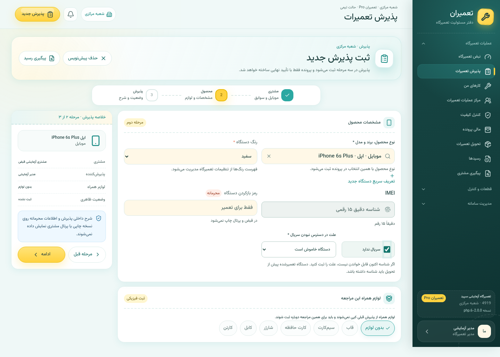
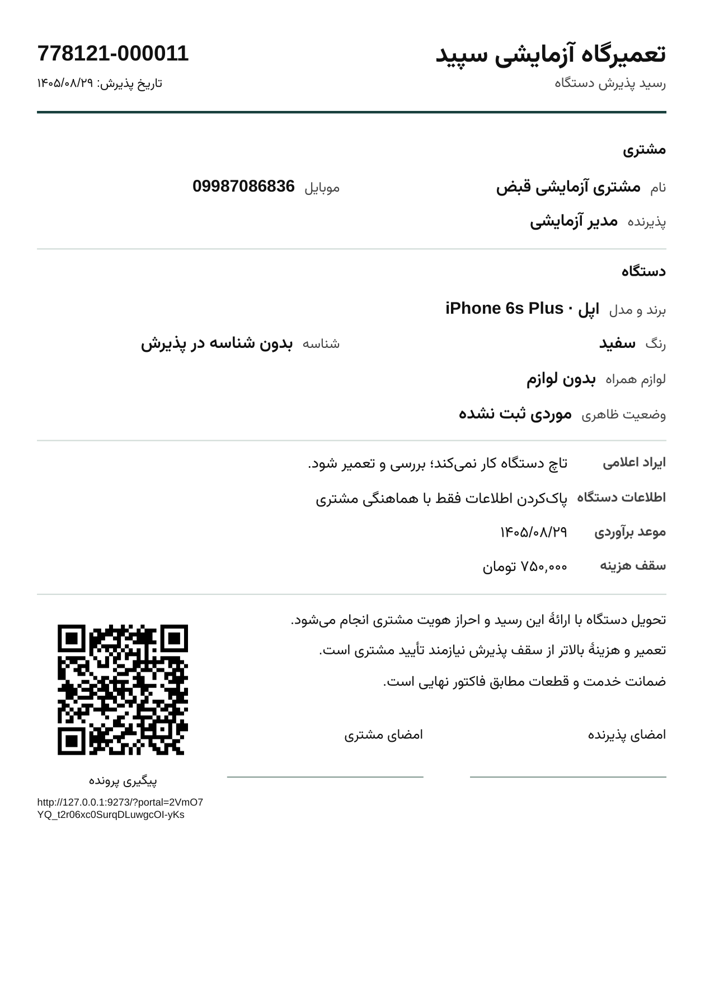
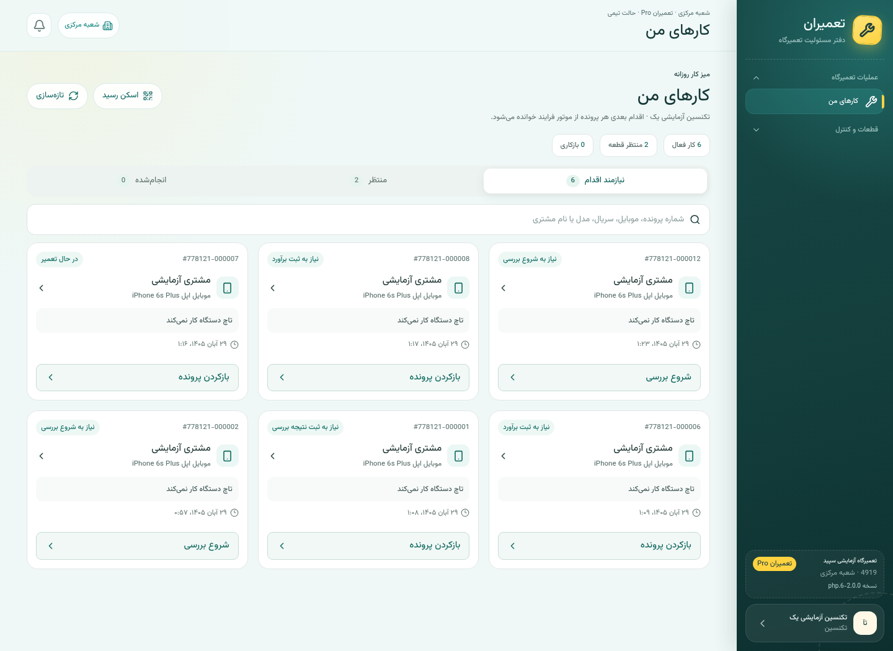
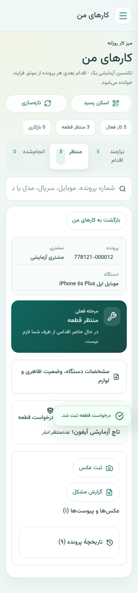
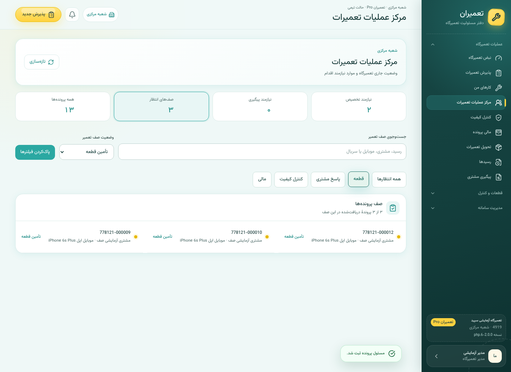

# اصلاحات تست پذیرش و کارتابل — PHP.6

نسخهٔ `2.0.0-php.6` اصلاحات اعلام‌شده در تست پذیرش، قبض و کار تکنسین را پیاده می‌کند. دامنهٔ اجرا نسخهٔ مستقل PHP است؛ مرجع منجمد و نسخهٔ Worker تغییر نکردند. انتشار ۲۲ نوامبر ۲۰۲۶ است؛ آزمون‌های اصلی پیش از راه‌اندازی دوبارهٔ محیط در همین نوبت اجرا و شواهدشان ذخیره شد. نصب و ارتقا جداگانه از ZIP نهایی بررسی می‌شوند.

## رفتار نهایی

در پذیرش، ستارهٔ شناسه در خط عنوان قرار دارد و علتِ «سریال ندارد» در دسکتاپ کنار همان انتخاب است؛ موبایل به یک ستون تبدیل می‌شود. «مرحله قبل» فلش راست و «ادامه» فلش چپ دارد؛ مرحلهٔ آخر «صدور قبض» است. خلاصه شمارهٔ مرحلهٔ جاری را نشان می‌دهد. تقویم، ماه قبل را از راست و ماه بعد را از چپ باز می‌کند. ذخیرهٔ نخستین پیش‌نویس، نسخهٔ صفر را صریح می‌فرستد و خطای دیده‌شده در تصویر تست رفع شده است.

سقف پذیرش و مبلغ پیشنهادی تکنسین به تومان، با جداسازی هزارگان و ارقام فارسی/عربی وارد می‌شوند. مرز کامپوننت همچنان رشتهٔ ریال صحیح می‌دهد؛ مثلاً `۷۵۰٬۰۰۰` تومان به `7500000` ریال تبدیل می‌شود. کارت برآورد، سقف پذیرش را از مبلغ جدید جدا نشان می‌دهد. مبلغ زیر سقف وارد تعمیر و مبلغ بالاتر وارد مسیر تأیید مشتری می‌شود.

چک‌باکس شرایط پذیرش حذف شد. درخواست جدید `receiptMode: issue_only` دارد: هیچ ردیف رضایت مشتری در `repair_case_receipt_terms` ساخته نمی‌شود؛ رویداد اولیه، شناسه و هش نسخهٔ فعال و `receiptConsentRecorded: false` را نگه می‌دارد. مجوز حذف اطلاعات دستگاه همچنان انتخاب مستقلی است. مسیر قدیمیِ ثبت رضایت، اعتبارسنجی نسخه و داده‌های تاریخی را حفظ می‌کند.

قبض از شبکهٔ باکس‌های بزرگ به ردیف‌های خوانا تبدیل شد. QR از کتابخانهٔ استاندارد `qrcode@1.5.4`، با نسخهٔ متناسب با طول داده، سطح M، حاشیهٔ چهار ماژول، رنگ سیاه/سفید و مربع ۳۴ میلی‌متری ساخته می‌شود. چاپ و دریافت PDF فقط همان قبض را در سند مستقل با اندازهٔ فیزیکی A5 و فونت محلی قرار می‌دهند؛ کل برنامه و فضای پنجرهٔ قبلی چاپ نمی‌شوند. همهٔ متن شرایط حفظ می‌شود؛ سند غیرعادی بلند می‌تواند چند صفحه شود.

«کارهای من» ابتدا کارت‌های خلاصه دارد. «شروع بررسی» همان پرونده را وارد عیب‌یابی و باز می‌کند. اطلاعات دستگاه/وضعیت ظاهری/لوازم، پیوست‌ها و تاریخچه به‌تدریج باز می‌شوند. در موبایل، فهرست هنگام باز بودن پرونده مخفی می‌شود و بازگشت صریح دارد. پس از انتقال، اطلاعات نسخهٔ پرونده در لایهٔ اصلی تازه می‌شود؛ تازه‌سازی همان پرونده، متن تایپ‌شده را با پیش‌نویس محلی قدیمی جایگزین نمی‌کند.

ثبت عکس اکنون فایل واقعی را در فضای خصوصی ذخیره می‌کند؛ گزارش مشکل، رویداد ممیزی‌شدهٔ سرور است و retry همان گزارش آن را تکرار نمی‌کند. تاریخچه رویدادهای قدیمی و انتقال‌های گردش‌کار را می‌خواند. درخواست قطعه از پرونده، با همان پروندهٔ انتخاب‌شده و تمرکز روی انتخاب کالا باز می‌شود؛ انتخاب پروندهٔ دیگر در بخش جمع‌شونده قرار دارد.

مرکز عملیات از صف «نیازمند تخصیص» شروع می‌شود؛ پرونده‌ای خودکار باز نمی‌شود. تخصیص، پرونده را از آن صف خارج می‌کند. فرم همکار و تغییرات استثنایی جمع‌شونده‌اند. انتظار قطعه، پاسخ مشتری، QC و مالی فیلترهای جدا دارند؛ انتخاب پروندهٔ تازه، مقادیر فرم قبلی را پاک می‌کند.

## مبنای طراحی و بررسی امنیتی

[UI/UX Pro Max](https://github.com/nextlevelbuilder/ui-ux-pro-max-skill)، نسخهٔ سورس `2de1134dc4d1cfe112934611ae5803ae17a1bd7e`، برای فرم کنترل‌شده، برچسب و واحد صریح، سلسله‌مراتب متن، افشای تدریجی، RTL و بازبینی responsive استفاده شد. جست‌وجوی نخست قبض نتیجهٔ مناسبی نداشت؛ جست‌وجوی محدودترِ typography و density و بررسی React مبنا شدند. چیدمان چاپ، تصمیم متناسب با این محصول است و قالب آمادهٔ رسمی اسکیل معرفی نمی‌شود.

بخش‌های مرتبط [ECC security-review](https://github.com/affaan-m/ecc/tree/main/skills/security-review) برای تغییرات فایل و گزارش بررسی شدند. صرف عضویت تعمیرگاه برای دسترسی تکنسین به عکس کافی نیست: مسئول اصلی یا همکار فعال باید باشد. shop و branch سروری، CSRF، MIME واقعی و فضای خارج از document root کنترل می‌شوند. مدارک هویتی/امضا برای تکنسین قابل فهرست یا دریافت نیستند. شکست audit، هم metadata و هم فایل تازه را برمی‌گرداند. این مرور هدفمند، یافته‌های امنیتی تاریخی نامرتبط مانند انقضای رمز موقت و محدودیت عمومی bcrypt را رفع‌شده اعلام نمی‌کند.

## شواهد اجرا

| مجموعه | نتیجه |
|---|---:|
| عکس، گزارش، صدور بدون رضایت ساختگی، ACL و rollback — HTTP/SQL | ۴۴ موفق |
| رگرسیون کامل قبلی API با مسیر رضایت قدیمی | ۱۰۲ موفق |
| شناسه، تحویل واقعی و عودت بدون تعمیر | ۳۵ موفق |
| پذیرش، تقویم، تومان، قبض و QR — Chromium | ۱۴ موفق |
| شروع بررسی، برآورد، عکس، گزارش و قطعه — Chromium | ۱۸ موفق |
| تخصیص، انتظار و responsive — Chromium | ۱۴ موفق |
| Node: پایه، قرارداد، شباهت و تبدیل تومان/ریال | ۲۷ موفق |
| نحو PHP سورس / آزمون بسته‌بندی | ۴۹ فایل / ۲ موفق |
| مرجع منجمد / منو / قرارداد frontend | ۶۷ هش / ۲۰ / ۲۷ محفوظ |

TypeScript و build موفق‌اند؛ هشدار قدیمی حجم bundle پابرجاست. قرارداد ریال و ۳۸ endpoint موجود حفظ شده‌اند. SQL تغییر نکرده است.

اسکن واقعی نرم‌افزاری با ZXing-C++ روی تصویر QR و روی رندر PDF انجام شد و هر دو لینک دقیق را برگرداندند. PDF عادی یک صفحهٔ `148 × 210 mm` بود. آزمون بارگذاری، عکس PNG واقعی را از API خصوصی خواند. آزمون شکست audit با trigger مصنوعی انجام و سپس trigger حذف شد. این‌ها اجرای محلی PHP 8.2/MariaDB 10.11 با دادهٔ مصنوعی‌اند.

[نتایج ساختاریافته](iteration-six-2026-11-22/verification.json)

## حدود و تحویل

هاست مقصد، Safari/WebKit، چاپگر فیزیکی و تمام ترکیب‌های نقش/اشتراک در مرورگر آزمون نشدند. اندازهٔ کاغذ و سربرگ/پابرگ چاپ را مرورگر و درایور نیز کنترل می‌کنند. هیچ عکس یا توکن واقعیِ تصاویر کاربر منتشر نشده و هیچ درخواست به هاست مشتری، پیامک یا پرداخت واقعی ارسال نشده است.

نصب تازه از ZIP install و ارتقا از php.5 از ZIP update است. هر دو از ZIP نهایی روی دیتابیس مصنوعی جدا نصب شدند. ارتقا، پرونده و سقف هزینهٔ قدیمی، محتوای دقیق عکس خصوصی، config و کلیدهای runtime را حفظ کرد؛ پذیرش جدیدِ بدون رضایت ساختگی، health و assets هش‌دار هر دو مقصد نیز موفق بودند. پس از ارتقا، نمایش نسخه و رسیدهای قدیمی در Chromium بدون خطای JavaScript بررسی شد. زمان فایل‌های ZIP این انتشار تازه شده تا استخراج‌کننده‌های حافظ زمان، تشخیص تغییر سورس در OPcache را مختل نکنند. بستهٔ ارتقا config، کلید، SQL، نصب‌کننده، فایل‌های مشتری یا لاگ ندارد. راهنمای `hosting/UPGRADE-FA.md` و فایل `release-verification-2.0.0-php.6.json` کنار بسته‌ها، مرجع انتقال و نتیجهٔ بررسی ZIP هستند.

Graphify با استخراج AST بیست‌وسه فایل سورس تازه شد: ۴٬۵۷۳ گره و ۱۱٬۱۴۷ رابطه. هش سورس‌ها و حفظ ۲۲ رابطهٔ کنارگذاشته‌شده بررسی شدند. هر دو viewer از HTTP محلی بدون درخواست خارجی و خطای JavaScript باز شدند؛ مرورگر این محیط بازکردن مستقیم file:// را مسدود می‌کند. لایهٔ معنایی اسناد تاریخی است و بازخوانی معنایی این گزارش ادعا نمی‌شود.
