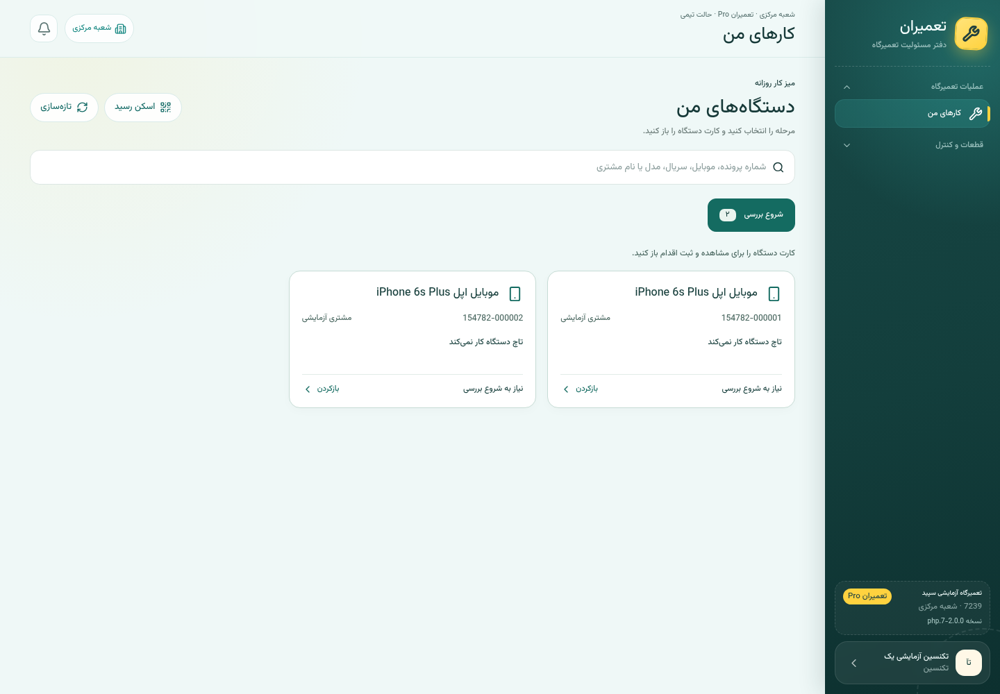
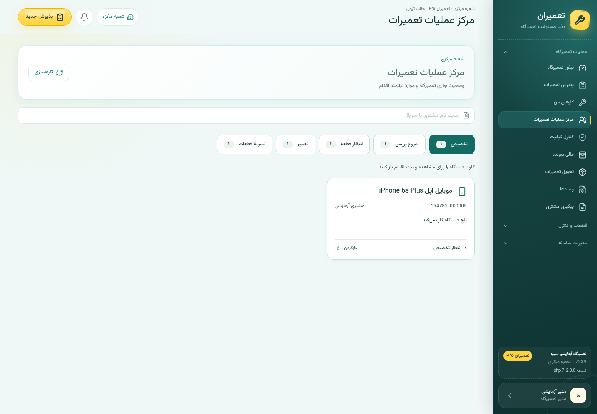
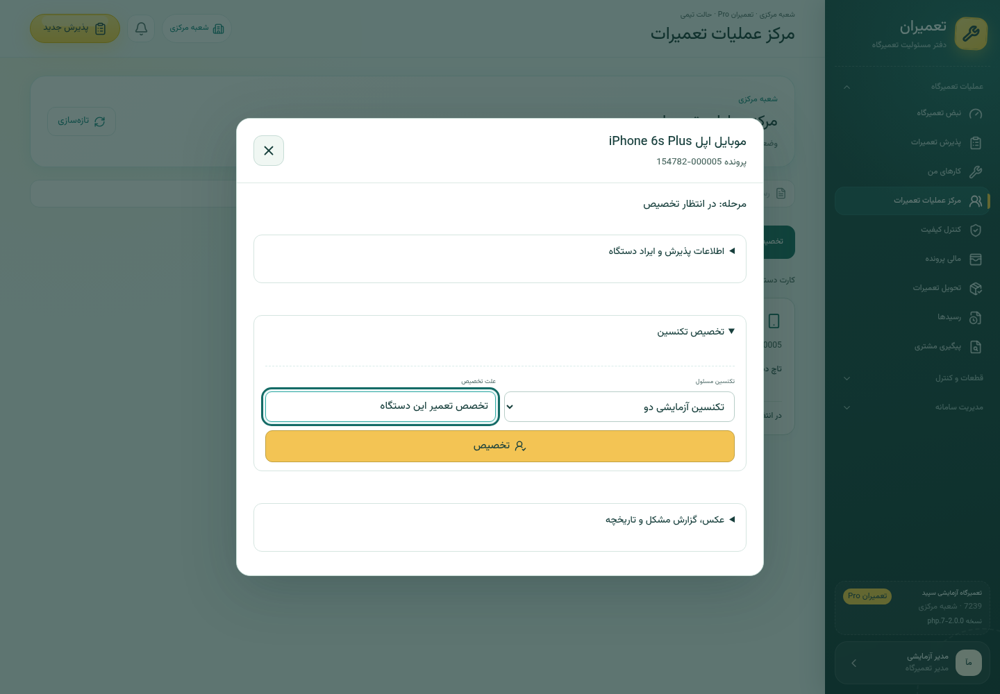
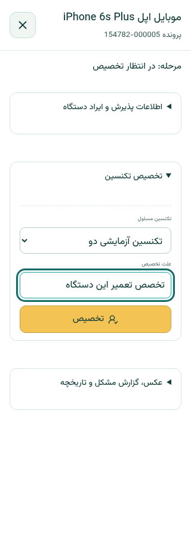

# مرحله و کارت دستگاه — PHP.7

هر دو پنل «کارهای من» و «مرکز عملیات تعمیرات» با الگوی مشترک **مرحله ← کارت دستگاه ← بازکردن پرونده ← ثبت اقدام همان مرحله** ساده شدند. این تغییر در نسخهٔ مستقل PHP انجام شده است؛ هاست کاربر یا مرجع منجمد تغییر نکرده‌اند.

## رفتار نهایی

صفحهٔ اصلی مرحله‌های دارای دستگاه، شمارش، جست‌وجو و کارت‌ها را دارد. کارت، دستگاه را به‌عنوان عنوان اصلی و شمارهٔ قبض، مشتری، ایراد و وضعیت را نمایش می‌دهد. فرم بلندِ کنار فهرست و دسته‌بندی‌های کلی قبلی حذف شده‌اند. مرحلهٔ آغازین از ترتیب فرایند انتخاب می‌شود و به آخرین ویرایش پرونده وابسته نیست. وضعیت ناشناخته گم نمی‌شود و در «سایر مراحل» باقی می‌ماند؛ مختومه‌ها نیز قابل دسترس‌اند.

بازکردن کارت، تغییر وضعیت یا شروع عیب‌یابی نیست. پنجرهٔ همان دستگاه باز می‌شود و ثبت مرحله با دکمهٔ صریح انجام می‌گیرد. بعد از موفقیت، پنجره بسته و کارت در مرحلهٔ جدید قرار می‌گیرد؛ خطای ثبت داخل پنجره باقی می‌ماند. پنجره در موبایل تمام‌صفحه است و بستن، Escape، کنترل تمرکز و غیرفعال‌شدن پس‌زمینه دارد. گزارش فنیِ ثبت‌نشده هنگام بستن سریع حفظ می‌شود.

اطلاعات پذیرش و ظاهر دستگاه، قطعات، عکس/گزارش/تاریخچه، همکار و اقدامات استثنایی در بخش‌های باز و بسته‌شونده‌اند. در تخصیص، فقط فرم انتخاب تکنسین و علت، اقدام اصلی است؛ فاکتورِ هنوز صادرنشده در ابتدای عیب‌یابی به‌عنوان مانع جاری نمایش داده نمی‌شود. موانع مرحلهٔ جاری همچنان دیده می‌شوند و قواعد سرور هنگام انتقال برقرارند.

برآورد زیر سقف وارد تعمیر و بالای سقف وارد تأیید مشتری می‌شود. ثبت تأیید تلفنی برای نقش مجاز، سپس انتقال به تعمیر را انجام می‌دهد. این‌ها دو درخواست مجازِ جدا هستند؛ اگر ارتباط پس از ذخیرهٔ تأیید قطع شود، خواندن وضعیت سرور، دکمهٔ ادامه به تعمیر را نشان می‌دهد و تأیید دوباره ثبت نمی‌شود. خطای سرور یا تعارض نسخه خودکار نادیده گرفته نمی‌شود.

از پروندهٔ مدیر، ورود به کارتابل فنی با همان دستگاه انجام می‌شود. قطعه با همان caseId و QC/مالی/تحویل با فیلتر همان قبض باز می‌شوند. ثبت نتیجه و کنترل مجوز و نسخه همچنان بر عهدهٔ API موجود است؛ SQL و مدل نقش تغییر نکرده‌اند.

## مبنای طراحی و دامنه

[UI/UX Pro Max](https://github.com/nextlevelbuilder/ui-ux-pro-max-skill) با نسخهٔ سورس `2de1134dc4d1cfe112934611ae5803ae17a1bd7e` بررسی شد. جست‌وجوی نخستِ progressive disclosure نتیجهٔ مرتبط نداشت؛ بازنویسی query، راهنمای برچسب فرم و بازخورد ثبت را برگرداند. طرح مرحله/کارت و حذف فرم موازی، تصمیم این محصول بر اساس درخواست صریح کاربر است و قالب رسمی اسکیل معرفی نمی‌شود. کنترل تمرکز مشترکِ قبلی دوباره استفاده شد؛ کتابخانهٔ جدیدی اضافه نشد.

۱۸ وضعیت سرور به مرحله‌های نمایشی دسته‌بندی می‌شوند؛ گروه کنترل کیفیت وضعیت‌های خودش را حفظ می‌کند و عنوان دقیق روی کارت دیده می‌شود. این دسته‌بندی فقط نمایش است و انتقال مجاز یا اختیارات کاربر را تعریف نمی‌کند. تب‌های مرحله با راست/چپ و Home/End نیز قابل استفاده‌اند. شمارش مربوط به مجموعهٔ دریافت‌شده از API موجود است؛ بازطراحی، محدودیت قبلی دریافت حداکثر ۵۰۰ پروندهٔ workflow را تغییر نمی‌دهد.

## شواهد همین نسخه

| بررسی | نتیجه |
|---|---:|
| مسیرهای دو نقش، انتقال کارت، گزارش/عکس/قطعه، هزینه، تأیید و بازیابی قطع ارتباط — Chromium + API واقعی | ۴۶ موفق |
| پیش‌نمایش عمل فعال و عنوان بسیار بلند در ۳۲۰ پیکسل | ۲ موفق |
| رگرسیون HTTP قبلی با نصب محلی همین نسخه | ۱۰۲ موفق |
| Node شامل دسته‌بندی وضعیت، ترتیب و وضعیت ناشناخته | ۲۹ موفق |
| TypeScript، build، نحو PHP، بسته‌بندی | موفق / موفق / ۴۹ فایل / ۲ موفق |
| مرجع منجمد، منو، قرارداد frontend، API موجود | ۶۷ هش / ۲۰ / ۲۷ / ۳۸ محفوظ |

کارت و پنجرهٔ هر دو پنل در ۱۰۲۴، ۷۶۸، ۳۹۰ و ۳۲۰ بدون اسکرول افقی بررسی شدند. بازکردن فقط‌خواندنی، نیاز به ثبت صریح مرحله، حفظ متن با بستن سریع، نمایش خطا در پنجره و بازگشت تمرکز نیز بررسی شد. تست قطع ارتباط فقط درخواست انتقالِ پس از ثبت تأیید را قطع کرد؛ API واقعیِ تأیید و ادامه اجرا شدند.

[نتایج ساختاریافته](stage-cards-2026-11-22/verification.json)

همهٔ اطلاعات و عکس‌ها مصنوعی‌اند. هاست واقعی، Safari، صفحه‌خوان واقعی و همهٔ ترکیب‌های Solo/Pro/نقش در این نوبت آزمون نشدند. آزمون چاپ و QR گزارش php.6 تاریخی است و دوباره به‌عنوان آزمون جاری ادعا نمی‌شود. هیچ پیامک، پرداخت یا درخواست به هاست مشتری انجام نشده است.

نصب تازه و ارتقا از php.6 در ZIPهای جدا تحویل می‌شوند؛ نصب واقعی از ZIP تازه و ارتقای نصب واقعی php.6 موفق بودند؛ پرونده، سقف هزینه، عکس خصوصی، config و کلیدهای runtime حفظ شدند و پذیرش جدید، health و assets هر دو مقصد کار کردند. نتیجه در `release-verification-2.0.0-php.7.json` کنار بسته‌هاست. Graphify با AST دوازده فایل سورس تازه شد: ۴٬۵۸۲ گره و ۱۱٬۱۸۴ رابطه. هش‌ها و ۲۲ رابطهٔ کنارگذاشته‌شده بررسی شدند. لایهٔ معنایی اسناد تاریخی است.
